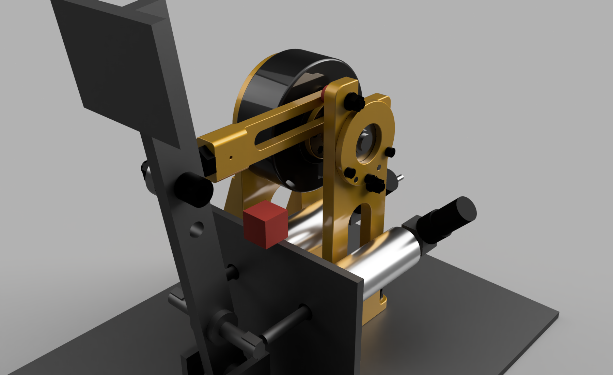
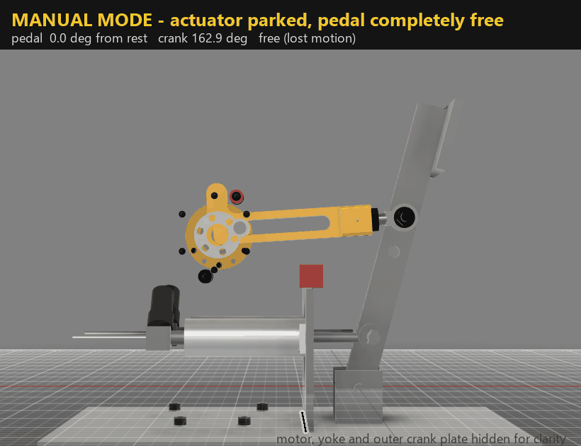
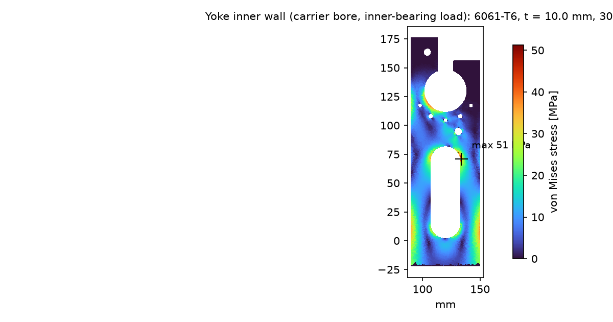
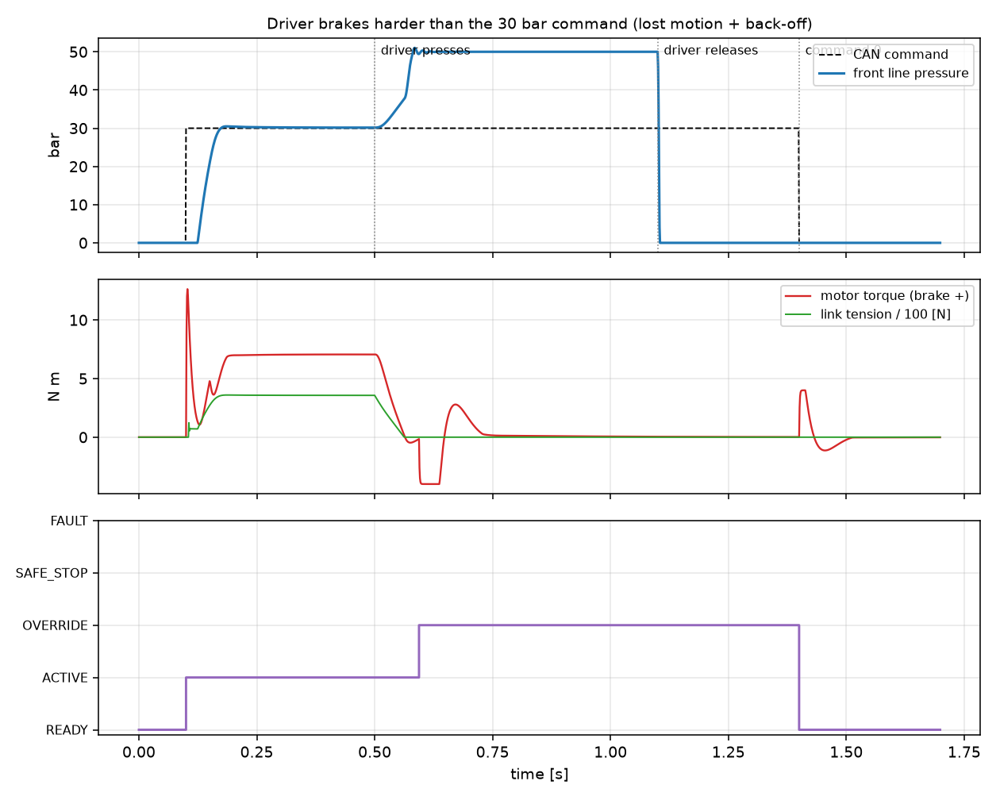

# driverless-service-brake

A driverless service-brake actuator for a Formula Student car, with a manual
override. I designed it for my Western Formula Racing recruit project in
October 2026. This repository holds the code behind every number in the
design: sizing, the mechanism, finite-element checks, hand calculations, a
closed-loop control simulation, the CAN interface and the Fusion 360 build of
the CAD.



*A CubeMars AK80-9 motor turns a 20 mm crank. The crank pin slides in a slot
at one end of a pull-link, and the other end is on a pin in the brake pedal.
The slot gives lost motion, so the driver can always press harder than the
actuator. Fusion render, rev D.*

## The problem

In driverless mode the car's computer has to brake through the same pedal and
master cylinders the driver uses. The driver must still be able to brake at any
time, and with no power or no command the system has to fail safe. The
Formula Student 2026 rules (T10, T11.9, T15) fix most of the constraints.

No team data was available, so the design sits on a **reference pedal box**
built from typical FSAE numbers:
- a 300 kg car;
- a 5:1 pedal ratio;
- two 5/8 in master cylinders.

Every assumption is in `params.py`, with a note on where it came from. Put
measured values there and re-run the chain to re-size everything for a real car.

## Results (rev D)

| | |
|---|---|
| Design point | 1.6 g, 59 bar front line pressure, 13.0 N m motor torque including a 1.25 margin (driver limit 14 N m, AK80-9 peak 18 N m) |
| Worst case | Motor at its 18 N m peak against the toggle-side hard stop: 1773 N in the link |
| Lowest factor of safety (yield) | 4.0 at the inner crank plate's stop lug, by 2D FE. Others: yoke wall 4.8, pull-link 6.1 at its end bridge (4.5 if the peak on the slot flank is counted) |
| Clearance | 63-pose sweep of the pedal and actuator, 0 clashes |
| Control | 48 ms 10-90 % rise to 40 bar (the 76 ms to 59 bar is set by the 600 bar/s ramp limit, not the actuator); override detected 94 ms after the driver presses; a 35 bar safe stop 100 ms after commands stop; pressure below 2 bar 36 ms after power loss |



*Motion study: manual braking with the actuator parked, a driverless apply,
then the driver pressing past the actuator (the slot opens) and the actuator
backing off.*

## How it fits together

```
params.py ── sizing.py ── mechanism.py ──┬── fea_run.py (fe2d.py) ── hand_calcs.py
                                         ├── make_poses.py ── cad/wfr_cad.py (Fusion)
                                         └── control_sim.py
can/*.dbc ── can_codec.py
```

| File | What it does |
|---|---|
| `params.py` | Every assumed car, brake and pedal number, each with a note on its source |
| `sizing.py` | Deceleration to axle loads, line pressure, master-cylinder force and pedal torque, with sensitivity tables |
| `trade_study.py` | Weighted decision matrix for the six actuator concepts |
| `mechanism.py` | Crank and slotted-link kinematics: park gap, lost motion, the toggle stop, and the link force and motor torque over the stroke. Writes `out/mechanism.json`, which everything after it reads |
| `fe2d.py` | A small 2D plane-stress finite-element solver (linear triangles, sparse solve), written because only SolidWorks SimulationXpress was available |
| `fea_run.py` | Validates the solver on a plate with a hole against Peterson, then checks the link, crank plate, stop lug and yoke at two mesh densities and two seeds |
| `hand_calcs.py` | Pins, bearings, threads, screws, dowels, gussets, the Hertz stress at the stop collar, and the pedal-moment rule check |
| `control_sim.py` | Two-DOF plant (crank and pedal) with the slot contact, pressure-volume model, current-limited motor and state machine; step, override, command-timeout and power-loss cases |
| `can_codec.py` | Packs and parses the three vehicle-bus frames (with alive counter and CRC-8), and checks them against the `.dbc` |
| `make_poses.py` | Poses for the clearance sweep and the motion-study frames |
| `cad/wfr_cad.py` | Builds the whole Fusion 360 model from `out/mechanism.json`, poses it, checks clearance and exports STEP |

## Run it

Python 3.10 or newer, with numpy, scipy, matplotlib and shapely
(`pip install -r requirements.txt`).

```
python run_all.py
python -m unittest discover tests
```

`run_all.py` runs the chain in order and writes every table, plot and JSON
result into `out/`. `cad/wfr_cad.py` runs inside Fusion 360 only. Run
`mechanism.py` first, then load the script from Fusion. Set `BRAKE_REPO` to
this folder if your loader runs it without a file path.

## How the FE was checked

`fe2d.py` uses constant-strain triangles, which under-read stress peaks. On a
plate with a hole (h = 0.5) it gives Kt = 2.24, against Peterson's 2.51, so FE
peaks are multiplied by 1.12. That factor comes from one hole at one mesh, and
the fillets that govern have a coarser mesh relative to their radius, so treat
it as approximate: it is why every FE factor of safety above is held to at
least 4. Each part is run at two mesh densities and a
second random seed. Where the peak sits in a loaded contact patch, the
governing stress is taken just outside it. The change between meshes stays
under 8 %. Every solve
reports its equilibrium error (about 1e-10 N).



## Control

The controller tracks a pressure command through the crank angle, with a slow
pressure-feedback trim. A driver pressing harder moves the pedal ahead of the
link, opening the slot. If the measured pressure is more than the crank angle
can explain, and above the command, for 20 ms, the controller flags an
override and backs the crank off to park. On a command timeout it holds a
35 bar safe stop. The rules' safe state is opening the shutdown circuit, which
is outside this simulation. With the power off, motor torque falls to zero.
The link only pulls, so the hydraulics and the pedal's return spring push the
pedal back and the brake releases.



## Limits

- It is a design study, not a built part. Nothing has been bench tested.
- All car numbers are assumptions (see `params.py`). The CAN IDs are
  placeholders to be aligned with the team's CAN map.
- Several CubeMars dimensions are marked HOLD until checked against a real
  motor: the flange spigot, bolt patterns and connectors.
- The finite-element checks are 2D. Out-of-plane effects are covered by the hand
  calculations, which take bounding cases. Pin loads are applied as a cosine
  pressure over the loaded half of the hole, with every nodal force along the
  load direction rather than normal to the surface.
- `sizing.py` gives the hydraulic load only; `mechanism.py` adds the pedal
  return spring, so its link force is about 11 % higher.
- The toggle-stop contact has the thinnest margin: Hertz stress against the
  shakedown limit gives 1.06 at the 18 N m peak, 1.21 at the 14 N m driver limit.

## License

Copyright © 2026 Navy Robson. All rights reserved. No license is granted; you are
welcome to read the code, but reuse or redistribution needs written permission.
